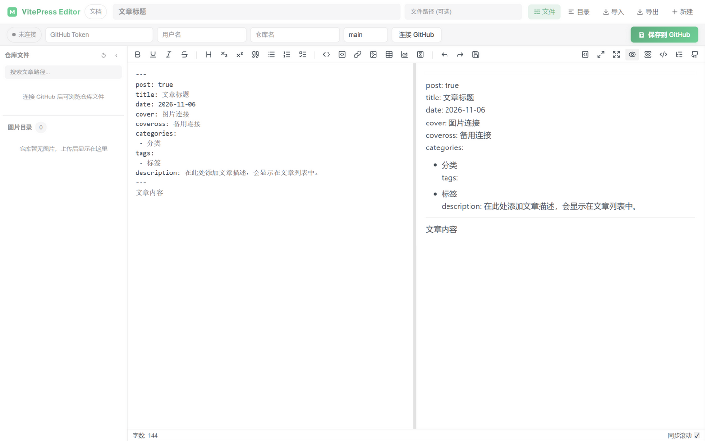
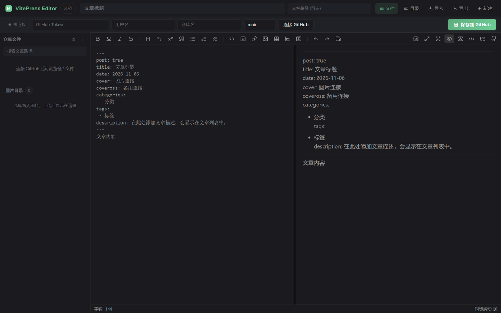
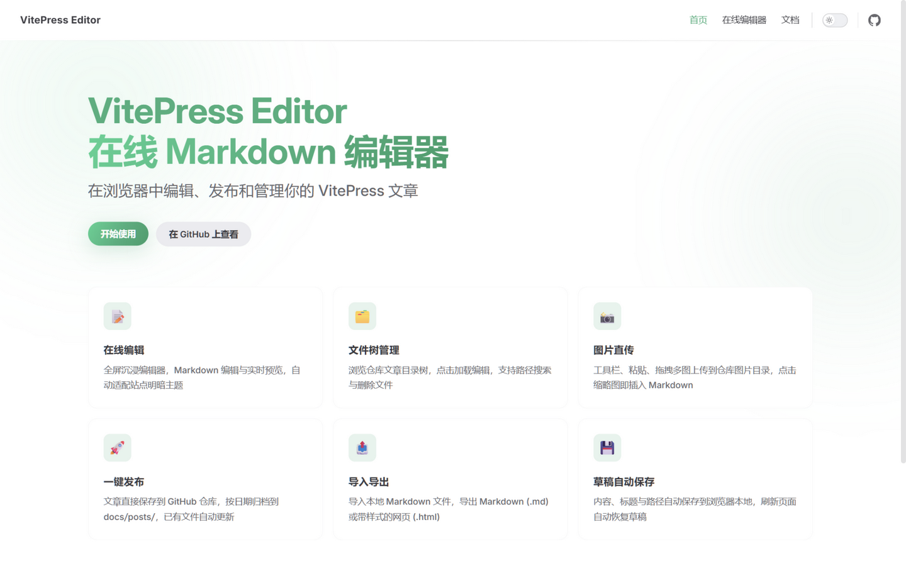

<div align="center">

# VitePress Editor

**在浏览器中编辑、发布和管理你的 VitePress 文章**

[在线体验](https://cubeyu.github.io/ViteEditor/pages/editor) · [使用教程](https://cubeyu.github.io/ViteEditor/guide/editor) · [接入已有项目](https://cubeyu.github.io/ViteEditor/guide/integrate) · [报告问题](https://github.com/cubeyu/ViteEditor/issues)



</div>

## ✨ 特性

- 🖥️ **全屏沉浸编辑** — 编辑器页铺满整个视口，双栏实时预览，自动适配站点明暗主题
- 📁 **仓库文件管理** — 文件树浏览仓库文章，点击加载编辑，支持搜索、删除（二次确认）
- 📸 **图片直传** — 工具栏 / 粘贴 / 拖拽多图上传到仓库图片目录，缩略图点击即可插入文章
- 🚀 **一键发布** — 文章直接保存到 GitHub 仓库 `docs/posts/`，按日期归档，已有文件自动更新
- 📰 **内置博客页** — `/posts/` 自动归档展示发布的文章（卡片式列表，无需维护）
- 🔍 **成品预览** — 发布前预览文章在博客页的真实渲染效果（标题 / 日期 / 分类标签 / 正文）
- 💾 **草稿自动保存** — 内容与路径实时存入浏览器本地，刷新 / 断网不丢稿
- 📤 **导入导出** — 导入本地 `.md` 文件，导出 Markdown（.md）或带样式网页（.html）
- 🧭 **目录导航** — 右侧文章目录树实时联动，点击跳转标题
- 🌐 **中英双语** — 跟随浏览器语言自动切换，可手动锁定；全站 UI 双语
- 🌓 **明暗双主题** — 跟随系统自动切换，可手动锁定；两套主题均精修
- 🔐 **会话级安全存储** — Token 仅存于 sessionStorage，关闭标签页即失效；保存路径白名单防止覆盖仓库任意文件

## 🎬 界面速览

| 深色模式 | 文档站首页 |
| --- | --- |
|  |  |

## 🚀 快速开始

> 环境要求：Node.js 18+（推荐 20）

```bash
# 克隆项目
git clone https://github.com/cubeyu/ViteEditor.git
cd ViteEditor

# 安装依赖（或 pnpm install）
npm install

# 启动开发服务器
npm run dev

# 构建生产版本
npm run docs:build
```

启动后访问 `/pages/editor` 即可进入编辑器。

## 📖 使用指南

完整教程见[在线文档](https://cubeyu.github.io/ViteEditor/guide/editor)，核心流程：

1. **创建 Token** — GitHub Settings → Developer settings → Fine-grained personal access tokens，仅需仓库 `Contents: Read and write` 权限
2. **连接仓库** — 在编辑器顶部连接栏填入 Token / 用户名 / 仓库名（分支默认留空，自动使用 main），点击「连接 GitHub」
3. **编写文章** — 标题必填；默认保存到 `docs/posts/{年}/{月}/`，也可自定义路径（仅限 `docs/posts/` 下的 `.md`）
4. **发布** — 点击「保存到 GitHub」，新文章自动创建、已有文章自动更新；发布后自动出现在[博客页](https://cubeyu.github.io/ViteEditor/posts/)

## 🧩 嵌入已有的 VitePress 项目

编辑器本体是一个自包含的 Vue 组件，运行时只依赖 `md-editor-v3` 与 `vue3-toastify`，几步即可嵌入你现有的 VitePress 站点：

- 安装两个依赖 → 复制 `editor.vue` → 注册组件 → 创建编辑器页面 →（可选）启用全屏沉浸布局

详见教程：[接入已有 VitePress 项目](https://cubeyu.github.io/ViteEditor/guide/integrate)

## 🛡️ 安全设计

- **Token 会话级存储**：Token 只保存在 `sessionStorage`，不落 `localStorage`，关闭标签页立即失效；请勿将 Token 硬编码进源码（会进入公开构建产物）
- **最小权限原则**：建议使用仅含 `Contents: Read and write` 的细粒度 PAT，并设置较短有效期
- **路径白名单**：自定义保存路径仅允许 `docs/posts/` 目录下的 `.md` 文件，上传文件名自动消毒，防止路径遍历覆盖仓库其他文件
- **纯前端边界**：本项目为静态站点，无服务端鉴权能力，请勿在公共设备上使用

## 📦 部署

项目自带 GitHub Pages 部署工作流（`.github/workflows/deploy.yml`，已固定 Actions 至 commit SHA）：

1. 仓库设置 → Pages → Build and deployment → Source 选择 **GitHub Actions**
2. 推送到 `main` 分支即自动构建部署

其他平台（Vercel / Netlify / Cloudflare Pages）导入仓库后选择 VitePress 预设即可。

> [!NOTE]
> 部署到仓库子路径时，需将 `docs/.vitepress/config.js` 中的 `base` 改为你的仓库名。

## ⚙️ 常用配置

| 配置 | 位置 | 说明 |
| --- | --- | --- |
| 站点 base 路径 | `docs/.vitepress/config.js` | 与仓库名保持一致 |
| 品牌色 | `docs/.vitepress/theme/custom.css` | 修改 `--vp-c-brand-*` 变量 |
| 文章模板 | `docs/.vitepress/theme/components/editor.vue` | 搜索 `defaultTemplate` |
| 默认文章目录 | `editor.vue` 中 `generateFileName` / `isFilePathValid` | 默认 `docs/posts/` |

## 🤝 贡献

欢迎提交 [Issue](https://github.com/cubeyu/ViteEditor/issues) 和 Pull Request！

## 📄 许可证

[MIT](LICENSE)
